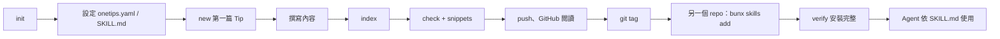

# OneTips 設計提案

狀態：草案 v0.1（2026-11-24）。尚未實作；本文件是實作前的規格。

## 1. 定位

**一句話**：OneTips 讓你只維護一份 Markdown，就能同時把技術 Tips 提供給 GitHub 上的人類讀者，以及依任務按需查閱的 Coding Agent。

**簡介**：每篇 Tip 只解決一個問題，用 front matter 描述 metadata，並以固定章節寫出適用情境、推薦做法、常見陷阱與檢查清單。OneTips 提供範本、驗證工具與索引產生器；每個 Tips 專案可以直接當作一個自足的 Agent Skill 發布與安裝。OneTips 不含任何特定技術的內容。

## 2. 目標使用者

| 角色 | 需求 | OneTips 提供 |
| --- | --- | --- |
| Tips 作者：函式庫維護者、團隊技術負責人、個人開發者 | 用最少維護成本累積「一題一解」的實務建議，並確保內容正確 | 範本、格式與連結驗證、片段驗證、索引產生 |
| 人類讀者 | 在 GitHub 上依主題找到建議，不必安裝任何東西 | README → 索引 → Tip 的相對連結導覽 |
| Coding Agent，以及把 skill 安裝到自己 repo 的開發者 | 依任務找到相關主題，只載入需要的章節與片段，而且不覆蓋專案既有決策 | 自足的 Agent Skill、Markdown 索引、選用的 OneTips 結構化查詢 |

## 3. 核心功能

1. **Tip 格式**：front matter（`id`、`summary`、`category`、`tags`、`related`、`applies_to`）加上 H1 標題與四個固定 H2 章節。程式碼片段必須有語言標籤，並以 `status=` 標示 `unverified`、`compiled` 或 `tested`。詳見 §10。
2. **GitHub 原生閱讀**：產生的 `INDEX.md` 與相對連結就是閱讀介面，不需要文件網站。
3. **單一來源**：只有 Tip 的 Markdown 由人撰寫；`INDEX.md` 一律由 metadata 產生，CI 會檢查它是否最新。
4. **驗證**：檢查設定、front matter、章節結構、相對連結與 anchor、索引一致性、skill 資料夾自足性，並依專案設定的指令編譯或測試片段。
5. **Agent Skill 封裝**：每個 Tips 專案的 `skills/<name>/` 資料夾就是要發布的 skill，可以用 `bunx skills add` 完整安裝。
6. **Agent 使用協定**：`SKILL.md` 範本規定 Agent 先確認專案版本與慣例、再查索引；只載入需要的章節；把範例當參考、把 checklist 當審查依據；不覆蓋專案決策；並能偵測安裝不完整。
7. **選用的結構化查詢**：OneTips CLI 提供 `find` 和 `show`，分別查索引和擷取單篇 Tip 的內容。沒有 CLI 或 Python 時，仍可從 `INDEX.md` 與 Markdown 定位；安裝不會帶入查詢工具。

## 4. 非目標

- 不提供任何技術領域的 Tips 內容，只提供範本與測試用 fixture。
- 不做文件網站產生器、向量或全文搜尋、資料庫、MCP server。這裡的檢索需求是「依分類、標籤或摘要找到主題，再載入單一章節」：可 grep 的 `INDEX.md` 加上固定 H2 章節就能滿足，而且 GitHub 與各種 Agent 都能直接讀取。目前找不到這套做法無法滿足的具體需求；日後若出現（例如單一專案大到 `INDEX.md` 無法有效篩選），應先提出該需求與量測數據，再另案討論。
- 不解析或比較版本範圍的語意。`applies_to` 的值是給人與 Agent 閱讀的字串，由各生態系自行定義。
- 不自建 skill 安裝器或 registry；安裝交給既有的 Agent Skills 工具，目標工具是 `skills` CLI。
- 不檢查外部 http(s) 連結，因為需要網路而且結果不穩定。
- 不管理多語翻譯。
- 不修改下游使用者的程式碼；Tips 只是參考與審查依據。

## 5. 最小可行範圍（MVP）

包含：

1. 正式格式規格 `docs/FORMAT.md`，內容即本文件 §10 的正式版。
2. Python CLI：`init`、`new`、`index`、`check`、`snippets`、`verify`，以及唯讀查詢 `find`、`show`（§11）。以 uv 管理開發環境，查詢核心須通過 mypyc 編譯與行為一致性驗證（§9 D3）。
3. 範本：`onetips.yaml`、`SKILL.md`、Tip、下游 `README.md`。
4. 測試 fixture：一個合格的最小 Tips 專案（虛構領域，2–3 篇 Tip），以及每種錯誤各一個 `invalid-*` 變體。
5. 端對端驗收腳本：用 `bunx skills add` 把 fixture 安裝到暫存 repo，並執行 §8 的檢查。

不包含：CI 範本產生、外部連結檢查、單一 Tips 專案發布多個 skill、索引分割、版本範圍解析。

## 6. 責任劃分與目錄結構

| 項目 | OneTips 框架 | 下游 Tips 專案 |
| --- | --- | --- |
| 格式規格（front matter、固定章節、片段狀態） | 定義並版本化（`format: 1`） | 遵守 |
| 領域、分類、版本主體、章節標題文字 | 提供預設值 | 在 `onetips.yaml` 定義 |
| Tip 內容與範例 | 不提供 | 撰寫 |
| `INDEX.md` | 提供產生器 | commit 產生結果，不手動修改 |
| 查詢 | 提供 `find`、`show` 與一致的輸出契約；查詢不掃描整個 `references/` | 定義分類、標籤與章節標題；不手動維護額外索引 |
| 驗證 | 結構、連結、索引、自足性檢查，以及執行片段指令的機制 | 為每種語言提供 compile/test 指令，並在自己的 CI 執行 |
| `SKILL.md` | 提供範本，內含 Agent 使用協定 | 填寫 `description`，可補充領域專屬指引 |
| 發布 | 確保 skill 資料夾自足、可被 `skills` CLI 安裝 | 打 tag 發布 |
| 安裝 | 不實作；提供 `verify` 檢查已安裝內容 | 在 README 寫明安裝指令 |

### 下游 Tips 專案的最小結構

```text
acme-tips/
├── README.md              # 手寫：簡介、安裝指令、連到 INDEX.md
├── onetips.yaml          # 專案設定（不會被安裝）
└── skills/
    └── acme-tips/         # 要發布的 Agent Skill：整個資料夾會被安裝
        ├── SKILL.md       # Agent 入口；name 必須等於資料夾名
        ├── INDEX.md       # 由 `onetips index` 產生，勿手改
        └── references/
            ├── retry-with-backoff.md
            └── idempotency-keys.md
```

規則：

- skill 資料夾以外的檔案都不會被安裝。
- skill 資料夾內的相對連結不得指向資料夾外。
- 資料夾內不得放 `metadata.json`，因為 `skills` CLI 不會複製這個檔名。

### OneTips 框架 repo（規劃）

```text
OneTips/
├── README.md
├── pyproject.toml         # 專案、建置、型別檢查與開發相依性
├── uv.lock                # 框架開發環境的鎖檔
├── docs/
│   ├── PROPOSAL.md        # 本文件
│   └── FORMAT.md          # MVP 產出：正式格式規格
├── templates/             # init / new 使用的範本
├── src/onetips/           # Python 匯入套件：CLI、解析與 I/O 邊界、mypyc 查詢核心
└── fixtures/
    ├── minimal/           # 合格的最小 Tips 專案
    └── invalid-*/         # 每種錯誤一個變體
```

## 7. 完整流程：從第一篇 Tip 到在另一個 repo 使用



### 作者端（Tips 專案 repo）

1. 安裝 OneTips CLI：發布後使用 `uv tool install onetips`，開發版使用 `uv tool install /path/to/OneTips`；安裝後的指令為 `onetips`。執行 `onetips init acme-tips --name acme-tips` 建立 §6 的結構，再進入 `acme-tips/`；初始索引有 0 篇。
2. 編輯 `onetips.yaml`：設定 `domain`、`subjects`、`categories`、`sections`，以及選填的 `snippets` 指令。
3. 編輯 `skills/acme-tips/SKILL.md` 的 `description`。描述要說明做什麼、何時使用，並包含觸發關鍵字。
4. 建立第一篇 Tip：`onetips new retry-with-backoff --category networking`。這會產生 `references/retry-with-backoff.md` 骨架；骨架在填寫完成前無法通過 `check`。
5. 撰寫內容：填寫 front matter、H1 與四個固定章節；程式碼片段標上語言與 `status=`。
6. 產生索引：`onetips index`。
7. 驗證：執行 `onetips check` 與 `onetips snippets`，兩者都必須 exit 0。
8. commit 並 push，在 GitHub 上依 README → `INDEX.md` → Tip 的路徑閱讀。
9. 發布：`git tag v0.1.0 && git push --tags`。

### 使用端（另一個 repo）

10. 安裝：`bunx skills add <owner>/acme-tips@v0.1.0 --skill acme-tips -a claude-code`，也可以省略 `-a`，在互動模式中選擇 Agent。`skills` CLI 會把 `skills/acme-tips/` **整個資料夾**安裝到所選 Agent 使用的 skill 目錄，並把 `computedHash` 寫入 `skills-lock.json`。實際路徑依所選 Agent 與安裝模式而定，以 `bunx skills list --json` 中該 skill 的 `path` 為準（下稱 `<installed>`）；例如只選 Claude Code 時為 `.claude/skills/acme-tips/`。
11. 若已安裝 OneTips CLI，可執行 `onetips verify <installed>`。預期 exit 0，且輸出的 `computedHash` 等於 `skills-lock.json` 中該 skill 的值。skill 安裝不會安裝 OneTips CLI、Python 或 uv，也不會執行片段。
12. 使用：開發者向 Agent 提出任務，Agent 依 `description` 啟用 skill，並照 `SKILL.md` 的協定執行：
    1. 讀目標專案的 manifest 或 lockfile，以及 AGENTS.md、lint 設定等既有慣例；
    2. 按標籤、分類與適用版本篩選主題。可執行 `onetips find --skill-dir <installed> --tag retry --json`，或直接搜尋 `INDEX.md`。
    3. 只讀相關 Tip 的必要章節。可執行 `onetips show --skill-dir <installed> retry-with-backoff --section checklist`，或依索引中的章節對照讀取 Markdown。
    4. 依專案風格改寫範例，並用 checklist 審查變更；
    5. 若 Tip 與專案決策衝突，依專案決策實作並指出衝突。
13. 更新：作者發布新 tag 後，使用端執行 `bunx skills update acme-tips`。

## 8. 驗收條件

每一條都必須能以指令或操作觀察到結果。fixture 指 `fixtures/minimal`；下列「`<tag>`」與「`<id>`」為該 fixture 中實際存在的值。

- **AC-1 GitHub 能正常閱讀**
  - 把 fixture 推到公開 GitHub repo 後，從 README 進入 `INDEX.md`，再進入每篇 Tip，以及 Tip 內 related 與交叉連結的目標，全程沒有 404。
  - front matter 顯示為表格。
  - 含 `status=` 的 code block 仍有語法高亮。
  - 指向章節的 anchor 能正確跳轉。
  - 自動化代理檢查：對 fixture 執行 `onetips check`，輸出 0 個 error。
- **AC-2 索引與文件一致**
  - 對 fixture 連續執行兩次 `onetips index`，兩次產生的 `INDEX.md` 位元組完全相同。
  - 修改任一 Tip 的 `summary` 但不重產索引時，`onetips check` exit 1，輸出含 `E-INDEX-STALE` 與檔案路徑；重產後 exit 0。
  - 新增 Tip 但未重產索引時，同樣回報 `E-INDEX-STALE`。
  - 測試逐列比對 `INDEX.md` 與每篇 Tip 的 id、標題、summary、tags、applies_to，以及片段計數，全部相等。
  - 修改專案的章節標題並同步修改 Tip 後，未重產的索引必須檢查失敗；重產後，`Sections` 對照表必須與設定一致。
- **AC-3 格式錯誤可診斷**
  - 每個 `fixtures/invalid-*` 變體執行 `onetips check` 時都 exit 1，並以 `路徑:行號: 錯誤碼` 回報唯一對應的錯誤碼。
  - 涵蓋的錯誤：重複 id、id 與檔名不符、未知分類、未知版本主體、缺少章節、章節順序錯、checklist 為空、code block 無語言、非法 status、相對連結失效、anchor 失效、連結逃出 skill 資料夾、`SKILL.md` name 與資料夾名不符。
- **AC-4 安裝後參考文件完整**
  - 在空的暫存 git repo 執行 `bunx skills add <來源> --skill acme-tips -a claude-code --copy -y`，來源分別使用本機路徑與 GitHub `<owner>/<repo>@<tag>`。以 `bunx skills list --json` 取得 `acme-tips` 的 `path`（下稱 `<installed>`）；`status` 必須為 `tracked`，且只選 Claude Code 時 `<installed>` 為 `.claude/skills/acme-tips`：
    1. `<installed>` 與來源 `skills/acme-tips/` 的遞迴 diff 為空；
    2. `onetips verify <installed>` exit 0；
    3. 輸出的 `computedHash`、`skills-lock.json` 中該 skill 的 `computedHash`，以及對來源資料夾執行 `verify` 得到的 hash，三者相等；
    4. 保存來源的路徑清單及內容雜湊，讓來源不再可存取後，對已安裝目錄重做比對與 `verify`；兩者仍通過。
  - 負向案例：`fixtures/invalid-outside-skill` 把 Tip 放在 skill 資料夾外，並由 `SKILL.md` 以 `../../tips/` 連結。來源 `check` 與安裝後 `verify` 都必須拒絕這個連結，回報 `E-LINK-ESCAPES-SKILL`；找到 `SKILL.md` 不代表參考內容已安裝。
- **AC-5 沒有 OneTips CLI 或 Python 仍能查到對應主題**
  - 在不提供 OneTips CLI、Python、uv 與 `mq` 的 Agent 執行環境，測試使用已安裝、無法存取原始 repo 的 fixture skill。
  - 從 `INDEX.md` 搜尋 fixture 中唯一使用的標籤，得到一筆 `references/<id>.md` 連結；用 `Sections` 對照找出 `checklist` 的實際 H2，只讀該章節。
  - 請 Agent 回報 Tip ID 與檢查項目：ID 和清單須與文件一致，transcript 不得呼叫查詢 CLI 或 `mq`。
- **AC-6 查詢有結構、只讀必要檔案**
  - 在 fixture 索引完整、但 `references/` 暫時不可讀時，執行 `onetips find --skill-dir <skill-dir> --tag retry --json`；仍只回傳標籤相符的列，包含路徑與適用版本。
  - 以索引將 `checklist` 對應到 `檢查清單` 的 fixture 執行 `onetips show --skill-dir <skill-dir> <id> --section checklist`；輸出只包含真正的 `## 檢查清單` 章節，不把程式碼圍欄中的同名行當成標題。即使另一篇 Tip 不可讀，結果仍相同。
  - 對同一篇 Tip 執行 `show --metadata --json` 應取得正確 `id`；執行 `show --section approach --code --lang python --status tested --json` 只回傳推薦做法內符合條件的片段，不執行程式碼。
  - 沒有匹配列或片段時，JSON 輸出 `[]`、exit 0。`show` 指定的 Tip 不在索引、檔案缺失或章節對照失效時，exit 1 並在 stderr 指出原因。
- **AC-7 片段狀態可信**
  - fixture 中標為 `tested` 的片段在設定指令下通過，`onetips snippets` exit 0。
  - `invalid-snippet-fails` 變體中有一個 `tested` 片段故意寫錯，`onetips snippets` 應 exit 1，並輸出含 `路徑:行號` 的 `E-SNIPPET-FAILED`。
  - 一個故意寫錯的 `unverified` 片段不會被執行，所以不影響結果。
  - 若片段宣告 `compiled`，但該語言沒有設定 compile 指令，應回報 `E-SNIPPET-NO-COMMAND`。
  - `INDEX.md` 的 Snippets 欄計數與檔案實際內容一致。
- **AC-8 Agent 尊重專案決策**（人工情境驗收，保留 transcript）
  - 目標 repo 的版本不在 `applies_to` 範圍內時，Agent 應指出不適用，不直接套用。
  - 目標 repo 的 AGENTS.md 規定與 Tip 的推薦做法衝突時，Agent 應依 repo 規定實作並指出衝突，不改寫既有程式碼。
- **AC-9 mypyc 編譯與行為一致**
  - CI 以 `uv run --locked mypy --strict src/onetips` 檢查型別；以 `uv build --wheel` 分別產出純 Python 與 mypyc wheel（§9 D3）。在分開的乾淨環境安裝 wheel，確認查詢核心分別從 `.py` 與原生擴充載入，避免測到 source tree。
  - 對兩個環境執行同一套 AC-6 查詢案例，比對 stdout、stderr 和 exit code；所有結果須一致，且保留編譯失敗作為 CI 失敗條件。
  - 比較純 Python 與編譯版時，分開記錄新程序執行 `onetips --help` 的冷啟動時間，以及同一程序對預載索引資料執行解析與篩選的時間。不把編譯成功或單次測量當成效能改善。

## 9. 關鍵取捨

### D1：skill 資料夾位置

| 選項 | 優點 | 缺點 |
| --- | --- | --- |
| **A. 內容直接放在 `skills/<name>/`（推薦）** | 只有一份檔案；git 來源可直接安裝；GitHub 閱讀與安裝看到同一份內容 | GitHub 路徑較深，需要 README 提供入口連結 |
| B. 作者寫在 `tips/`，建置時複製到 `skills/<name>/` 並 commit | 作者路徑短 | repo 內有兩份內容，違反單一來源；忘了建置就會發布舊內容 |
| C. 在 repo 根放 `SKILL.md` | 路徑最短 | 整個 repo（README、設定、CI）都會被安裝，而且會遮蔽其他 `SKILL.md` |

### D2：片段驗證狀態的標記方式

| 選項 | 優點 | 缺點 |
| --- | --- | --- |
| **A. 寫在 info string：```` ```ts status=tested ````（推薦）** | 緊貼程式碼；CLI 可由同一個 Markdown 節點取得語言與狀態 | GitHub 渲染後讀者看不到，改由 `INDEX.md` 顯示統計；語法高亮由 AC-1 驗證 |
| B. 在片段前加 HTML 註解 `<!-- onetips: status=tested -->` | GitHub 不顯示；可攜帶更多欄位 | 標記與程式碼分離，容易錯位，查詢需跨節點配對 |
| C. 在片段前加可見文字標籤 | 讀者看得到 | 屬於內容文字，需要固定措辭與語言，解析脆弱 |

### D3：Python + uv 與 mypyc 建置

- **名稱**：框架、PyPI 發行名稱、Python 匯入套件與 CLI 指令一律為 OneTips／`onetips`。
- **開發**：使用 CPython、`pyproject.toml` 與 `uv.lock`；以 `uv sync --locked` 同步開發環境。以 `mypy --strict` 檢查框架程式碼。
- **編譯邊界**：第三方 Markdown／YAML 解析器、檔案 I/O 和 CLI 參數處理留在純 Python 層。解析器輸出先正規化為明確型別的資料，再傳入查詢核心。用同一份核心原始碼處理索引列轉換及篩選、章節定位與片段篩選；不維護另一套原生實作，也不為了 mypyc 重寫 Markdown 解析器。
- **建置**：用 `uv build --wheel` 呼叫 `setuptools.build_meta`，建置時以 `mypycify` 編譯核心模組。預設建純 Python wheel；設定 `ONETIPS_MYPYC=1` 建編譯版，切到編譯模式後缺少 C 工具鏈或編譯失敗須直接失敗，不得回退成純 Python wheel。
- **發行取捨**：純 Python wheel 不需要替每個 CPython ABI／平台組合各建一份；原生 wheel 則需要建置矩陣。首版以純 Python wheel 為預設交付，CI 必須能建並測編譯版；是否公開發行原生 wheel，依 AC-9 的量測結果決定。Python CLI 的發行渠道不綁定 Tips 的 Git 發布。

### D4：Tips 專案的發布方式

| 選項 | 優點 | 缺點 |
| --- | --- | --- |
| **A. Git tag（推薦）** | 不需要額外平台；可用 `owner/repo@vX` 固定版本；`skills-lock.json` 會記錄 commit；不限 GitHub，GitLab 與任意 git URL 也支援 | 使用端需要能存取該 git host |
| B. 壓縮檔下載 URL | 可以在 git host 以外散佈 | 需要額外建置與託管；預設上限 10 MiB |
| C. npm 套件＋`skills experimental_sync` | 版本跟著相依套件走 | 依賴實驗功能，行為可能變動 |

### D5：索引格式

| 選項 | 優點 | 缺點 |
| --- | --- | --- |
| **A. 只產生 `INDEX.md`（推薦）** | GitHub、Agent 與 `find` 共讀同一個產物 | 產生器與查詢須共用索引格式契約 |
| B. `INDEX.md`＋`index.json` | 程式化使用方便 | 多一個產物，而 MVP 沒有使用者 |

### D6：結構化查詢介面

採用可組合的 CLI 參數與固定 JSON 輸出，而不是通用查詢 DSL。`find` 只掃描一次索引，不列舉或開啟 `references/`；`show` 只讀索引與指定的 Tip。先以減少 I/O 與解析量控制成本，不加常駐快取。

## 10. 格式規格（format 1）

實作使用的正式規格見 [FORMAT.md](FORMAT.md)。

### 10.1 `onetips.yaml`

```yaml
format: 1
name: acme-tips              # skill 名稱 = skills/<name>/ 資料夾名
domain: Acme SDK             # 用於 SKILL.md 與 INDEX.md 的標題
subjects:                    # applies_to 允許的鍵：版本主體 ID → 顯示名稱
  acme-sdk: Acme SDK
  node: Node.js
categories:                  # 允許的分類；順序即 INDEX.md 的分組順序
  - id: networking
    title: Networking
  - id: data
    title: Data
sections:                    # 四個固定章節的標題文字；鍵固定，值可改（例如改為中文）
  when: When to Use
  approach: Recommended Approach
  pitfalls: Pitfalls
  checklist: Checklist
snippets:                    # 選填；鍵為 code fence 的語言標籤
  ts:
    ext: ts
    compile: tsc --noEmit --strict {file}
    test: bun test {file}
    timeout: 120             # 秒，選填，預設 120
```

- `name` 必須符合 Agent Skills 規格：1–64 字元，只能有小寫英數字與 `-`，不能以 `-` 開頭或結尾，不能有連續的 `--`。
- `subjects` 的鍵與 `categories[].id` 都使用 kebab-case。
- 片段指令可用的佔位符：`{file}` 是擷取出的片段檔絕對路徑，`{dir}` 是其暫存目錄。指令在 repo 根目錄執行，使用平台預設 shell，exit 0 表示通過。

### 10.2 Tip front matter

```yaml
---
id: retry-with-backoff
summary: 對暫時性錯誤以指數退避加隨機抖動重試，避免同步重試放大故障。
category: networking
tags: [retry, backoff, timeout]
related: [idempotency-keys]
applies_to:
  acme-sdk: ">=2.0 <3.0"
  node: ">=20"
---
```

| 欄位 | 必填 | 規則 |
| --- | --- | --- |
| `id` | 是 | 符合 `^[a-z0-9]+(-[a-z0-9]+)*$`，最多 64 字元；必須等於檔名（不含 `.md`）；全專案唯一；發布後不可改名或重複使用 |
| `summary` | 是 | 單行，1–200 字元，說明「這篇解決什麼問題」 |
| `category` | 是 | 必須是 `categories[].id` 之一 |
| `tags` | 是 | 至少一個，每個都符合 `id` 的字元規則 |
| `related` | 否 | 其他 Tip 的 `id`；必須存在，且不得包含自己 |
| `applies_to` | 是 | map；鍵必須存在於 `subjects`；值為非空的版本範圍字串，OneTips 不解析其語意；`"*"` 表示與版本無關 |
| `x-*` | 否 | 專案自訂的延伸欄位，OneTips 忽略 |

其他欄位一律視為 `E-UNKNOWN-KEY`。標題不放在 front matter，而是取自 H1，避免同一檔案內有兩處標題需要同步。

### 10.3 本文結構

- front matter 之後的第一個非空行必須是唯一的 H1，作為 Tip 標題。
- `sections` 定義的四個 H2 必須各出現恰好一次，順序為 when → approach → pitfalls → checklist。章節之間或之後可以加入其他 H2，但標題不得與固定章節相同。
- checklist 章節至少要有一個 task list 項目（`- [ ] ...`），每一項都必須是可以判定是否符合的陳述。
- 「一篇只解決一個問題」屬於編輯原則，工具無法檢查。如果 `summary` 無法用一句話說完，或需要兩種推薦做法，就拆成兩篇並用 `related` 互相連結。

完整範例：

````markdown
---
id: retry-with-backoff
summary: 對暫時性錯誤以指數退避加隨機抖動重試，避免同步重試放大故障。
category: networking
tags: [retry, backoff, timeout]
related: [idempotency-keys]
applies_to:
  acme-sdk: ">=2.0 <3.0"
  node: ">=20"
---
# 以指數退避重試暫時性錯誤

## When to Use

呼叫 Acme API 時遇到 429、503 或連線逾時，且該操作可以安全重試（見 [idempotency-keys](idempotency-keys.md)）。

## Recommended Approach

使用 SDK 內建的 `retry` 選項，並設定次數與延遲上限；不要自己包 while 迴圈。

```ts status=tested
const client = new AcmeClient({
  retry: { maxAttempts: 4, baseDelayMs: 200, maxDelayMs: 5_000, jitter: true },
});
```

## Pitfalls

- 對非冪等操作（例如建立訂單）重試，造成重複寫入。
- 沒有設定 `maxDelayMs`，導致退避時間沒有上限。

## Checklist

- [ ] 只對可重試的錯誤碼重試
- [ ] 非冪等操作帶有 idempotency key
- [ ] 重試次數與最大延遲都有上限
````

`onetips new` 產生的骨架包含空的 `summary` 與 `tags`、空的 H1，以及四個空章節與一個空的 checklist 項目。作者填寫完成前，`check` 不會通過。

### 10.4 程式碼片段

- 每個 fenced code block 都必須有語言標籤，否則回報 `E-CODE-LANG`。
- 驗證狀態寫在 info string，例如 ```` ```ts status=tested ````。可用值：
  - `unverified`：預設值，可以省略；
  - `compiled`：通過該語言的 `compile` 指令；
  - `tested`：先執行 `compile`（若有設定），再通過 `test` 指令。
  其他值回報 `E-CODE-STATUS`。
- `onetips snippets` 只執行 `compiled` 與 `tested` 片段。每個片段會擷取為 `<tmp>/<id>/<行號>.<ext>`，然後執行對應指令。
- 片段必須能獨立編譯或測試；需要外部上下文的片段應保持 `unverified`。
- 片段超過 60 行時回報 `W-SNIPPET-LONG`，僅為警告，不會讓檢查失敗。

### 10.5 連結

- 相對連結必須指向存在的檔案，否則回報 `E-LINK-BROKEN`。`#anchor` 依 GitHub 標題 slug 規則驗證，失效時回報 `E-LINK-ANCHOR`。
- skill 資料夾內（`SKILL.md`、`INDEX.md`、`references/`）的相對連結不得解析到資料夾外，否則回報 `E-LINK-ESCAPES-SKILL`。這是安裝後仍可使用的前提。
- Tip 之間以同資料夾相對路徑互連，例如 `[...](idempotency-keys.md)`。
- repo 根目錄的 `README.md` 也要驗證相對連結，且至少要有一個連結指向 `skills/<name>/INDEX.md`，否則回報 `E-README-NO-INDEX-LINK`。
- 不檢查 http(s) 連結。

### 10.6 `INDEX.md`（產生檔）

```markdown
<!-- Generated by `onetips index`. Do not edit by hand. -->
# Acme SDK Tips — Index

2 tips. Each row links to one tip in `references/`.

### Sections

- `when`: When to Use
- `approach`: Recommended Approach
- `pitfalls`: Pitfalls
- `checklist`: Checklist

## networking — Networking

|ID|Title|Summary|Tags|Applies to|Snippets|
|---|---|---|---|---|---|
|[retry-with-backoff](references/retry-with-backoff.md)|以指數退避重試暫時性錯誤|對暫時性錯誤以指數退避加隨機抖動重試，避免同步重試放大故障。|retry, backoff, timeout|acme-sdk >=2.0 <3.0; node >=20|tested 1, compiled 0, unverified 0|
```

- `Sections` 由 `onetips.yaml` 的 `sections` 一次產生，依上列順序輸出；標題為非空、互異的單行純文字，必須與對應的 H2 標題相同。即使沒有 Tip 也保留此對照。`show` 和不使用 CLI 的 Agent 都從這裡取得穩定鍵對應的標題，不從 `SKILL.md` 或 repo 根目錄讀取設定。
- 依 `categories` 的順序分組，沒有 Tip 的分類不輸出。
- 同一組內依 `id` 的位元組序排列。
- 表格儲存格中的 `|` 轉義為 `\|`。
- 檔尾只有一個 LF；相同輸入必須產生位元組相同的輸出。
- 欄位標籤固定使用英文，方便 Agent 用 grep 查詢。

### 10.7 `SKILL.md` 範本

`init` 會依 `onetips.yaml` 填入 `name`、`domain` 與 `subjects` 的顯示名稱。章節對照只寫入產生的 `INDEX.md`，不複製到 `SKILL.md`：

```markdown
---
name: acme-tips
description: Acme SDK tips — one problem per tip, each with a recommended approach, pitfalls, and a review checklist. Use when writing, reviewing, or debugging code that uses Acme SDK or Node.js.
metadata:
  onetips-format: "1"
---

# Acme SDK Tips

Each tip in `references/` solves one problem. [INDEX.md](INDEX.md) lists every tip with its category, tags, applicable versions, and snippet verification status.

## Workflow

1. **Check the target project first.** Find the versions of Acme SDK and Node.js the project uses (manifests, lockfiles, toolchain files) and its conventions (AGENTS.md, CONTRIBUTING, lint and format config, existing code). These come before any tip.
2. **Find relevant tips.** Search [INDEX.md](INDEX.md) by tag, category, or keyword. Check each result's applicable versions against the target project. Skip tips that exclude those versions; if applicability cannot be confirmed, say so instead of assuming the tip applies.
3. **Load only what you need.** Use the `Sections` mapping in [INDEX.md](INDEX.md) to locate the relevant H2 in `references/<id>.md`. Read the Tip's front matter and only the sections required by the task.
4. **Treat snippets as references.** The code fence info string carries `status=tested`, `status=compiled`, or no status (unverified). Adapt snippets to the project's style and APIs; verify unverified snippets before relying on them.
5. **Use the checklist for review.** When reviewing or finishing a change, report each checklist item as met, not met, or not applicable.
6. **Do not override project decisions.** If a tip conflicts with an existing project convention or decision, follow the project, point out the conflict, and do not refactor existing code to match the tip unless asked.
7. **Detect incomplete installs.** If a file linked from INDEX.md is missing, the skill was not installed completely. Say so and recommend reinstalling; do not reconstruct the content from memory.

## Optional: structured queries with OneTips

If `onetips` is already installed, pass the directory that contains this `SKILL.md` as `--skill-dir`. The installed location depends on the agent; for example, Claude Code project skills live in `.claude/skills/acme-tips`. Run the commands from the target repository and replace `<skill-dir>` with the actual path.

- Find matching tips: `onetips find --skill-dir <skill-dir> --tag retry --json`
- Read one section: `onetips show --skill-dir <skill-dir> retry-with-backoff --section checklist`
- Get matching snippets: `onetips show --skill-dir <skill-dir> retry-with-backoff --section approach --code --lang ts --status tested`

If the CLI is unavailable, use the index and Markdown directly; do not install tools just to read the skill.
```

- `SKILL.md` 必須符合 Agent Skills 規格：`name` 等於資料夾名，`description` 為 1–1024 字元，且必須連結到 `INDEX.md`。
- 超過 500 行時回報 `W-SKILL-LONG`。

## 11. CLI 介面

| 指令 | 行為 | 失敗條件 |
| --- | --- | --- |
| `onetips init [dir] --name <name>` | 在 `dir`（預設 `.`）建立 `README.md`、`onetips.yaml`、`skills/<name>/SKILL.md`，以及 0 篇的 `INDEX.md` | 任一目標檔已存在時，不寫入任何檔案並列出衝突，exit 2；`name` 不合規時 exit 2 |
| `onetips new <id> --category <c>` | 建立 `references/<id>.md` 骨架；不修改 `INDEX.md`，因為 `index` 是唯一寫入索引的指令 | `id` 已存在或不合規、分類未定義時 exit 2 |
| `onetips index [--check]` | 從所有 Tip 的 metadata 重寫 `INDEX.md`；加上 `--check` 時不寫檔，索引過期就 exit 1 並印出 diff | 任一 Tip 的 metadata 有錯時不寫檔，exit 1 |
| `onetips check` | 執行所有靜態檢查：設定、Tip 格式、連結、索引是否最新（等同 `index --check`），以及對來源 skill 資料夾執行 `verify` 的內容 | 有 error 時 exit 1；只有 warning 時 exit 0 |
| `onetips snippets [--id <id>]` | 依 §10.4 執行 `compiled` 與 `tested` 片段 | 片段失敗或缺少指令時 exit 1 |
| `onetips verify <skill-dir>` | 不需要 `onetips.yaml`。檢查 `SKILL.md` front matter、`INDEX.md` 存在且被 `SKILL.md` 連結、`INDEX.md` 的每個連結都存在、`references/*.md` 都列在 `INDEX.md`、沒有連結逃出資料夾；最後輸出 `computedHash: <hex>`，演算法與 `skills` CLI 文件中 `skills-lock.json` v2 的 content hash 相同 | 任一項不符時 exit 1 |
| `onetips find --skill-dir <dir>` | 只讀 `INDEX.md`；依選填條件篩選主題 | 索引缺失或格式不符時 exit 1 |
| `onetips show --skill-dir <dir> <id>` | 透過索引找到指定 Tip，擷取 metadata、章節或程式碼 | 索引無效、找不到 Tip、Tip 無法讀取或指定章節不符時 exit 1 |

- exit code：0 表示通過，1 表示驗證失敗，2 表示用法或設定錯誤。
- 驗證指令每個問題輸出一行 `<path>:<line>: <CODE> <message>`，最後輸出 `N errors, M warnings`。`find`、`show` 的 stdout 只寫查詢結果；錯誤及用法診斷在 stderr。

錯誤碼：

| 錯誤碼 | 觸發條件 |
| --- | --- |
| `E-CONFIG` | `onetips.yaml` 缺少欄位或格式錯誤 |
| `E-READ` | 必要的檔案或目錄無法讀取 |
| `E-FRONTMATTER-INVALID` / `E-APPLIES-TO` | YAML front matter 無效 / 適用版本欄位無效 |
| `E-INDEX-FORMAT` | 索引不存在、無法讀取或不符合產生格式 |
| `E-FRONTMATTER-MISSING` | Tip 沒有 front matter |
| `E-UNKNOWN-KEY` | front matter 含有未定義、且不以 `x-` 開頭的鍵 |
| `E-ID-FORMAT` / `E-ID-FILENAME` / `E-ID-DUPLICATE` | id 字元不合規 / id 與檔名不符 / id 重複 |
| `E-SUMMARY` / `E-TAGS` | summary 為空、多行或超長 / tags 為空或不合規 |
| `E-CATEGORY-UNKNOWN` / `E-SUBJECT-UNKNOWN` / `E-RELATED-UNKNOWN` | 引用了未定義的分類 / 版本主體 / Tip |
| `E-H1` | 缺少 H1、有多個 H1，或 H1 不是第一個區塊 |
| `E-SECTION-MISSING` / `E-SECTION-ORDER` / `E-SECTION-DUPLICATE` | 固定章節缺少 / 順序錯 / 重複 |
| `E-CHECKLIST-EMPTY` | checklist 章節沒有 task list 項目 |
| `E-CODE-LANG` / `E-CODE-STATUS` | code block 沒有語言標籤 / `status` 值非法 |
| `E-LINK-BROKEN` / `E-LINK-ANCHOR` / `E-LINK-ESCAPES-SKILL` | 相對連結失效 / anchor 失效 / 連結逃出 skill 資料夾 |
| `E-README-NO-INDEX-LINK` | 根目錄 README 沒有連到 `INDEX.md` |
| `E-INDEX-STALE` / `E-INDEX-MISSING-ENTRY` | `INDEX.md` 與 metadata 不一致 / `references/` 中的 Tip 未列入索引 |
| `E-SKILL-FRONTMATTER` / `E-SKILL-NAME-MISMATCH` / `E-SKILL-NO-INDEX-LINK` | `SKILL.md` front matter 不合規 / `name` 不等於資料夾名 / 沒有連到 `INDEX.md` |
| `E-SNIPPET-NO-COMMAND` / `E-SNIPPET-FAILED` | 宣告的狀態沒有對應指令 / 指令失敗或逾時 |
| `W-SNIPPET-LONG` / `W-SKILL-LONG` | 片段超過 60 行 / `SKILL.md` 超過 500 行 |

### 11.1 結構化查詢契約

`find` 和 `show` 都是唯讀操作。`--skill-dir` 指向 skill 根目錄，來源 repo 與安裝副本都適用；兩者都不讀 `onetips.yaml`、不存取網路、不執行程式碼片段。

- **`find`**：選填 `--id <id>`、`--category <id>`、`--tag <tag>`、`--keyword <text>` 和 `--json`。不同篩選條件以 AND 組合；前三者精確比對，關鍵字以不分大小寫的子字串比對標題與摘要。無條件時列出全部，保持索引順序。預設以 Markdown 列出結果，包含適用版本；JSON 為陣列，每筆固定含 `id`、`title`、`summary`、`category`、`tags`（字串陣列）、`applies_to`（索引中的顯示字串）與 `path`（skill 根目錄相對路徑）。不替 Agent 判斷版本相容性。
- **`show`**：必須指定 `--metadata`、`--section <key>` 或 `--code`。`--metadata` 不與其他選取參數並用；預設輸出原 YAML，`--json` 輸出 §10.2 定義的標準欄位物件，不含 `x-*` 延伸欄位。`--section` 使用 `when`、`approach`、`pitfalls`、`checklist` 四個穩定鍵；依真正的頂層 H2 定位，輸出原 Markdown，自標題起至下一個頂層 H2 或 EOF，並包含下層標題。單純取章節不接受 `--json`。
- **`show --code`**：未指定章節時取該 Tip 內的圍欄程式碼；可加 `--section` 限定範圍，以及 `--lang <lang>`、`--status <status>` 精確比對，條件以 AND 組合。保留文件順序，省略狀態視為 `unverified`。預設輸出原 Markdown 圍欄；`--json` 輸出陣列，每筆為 `language`、`status`、`code` 三個字串欄位。`--lang` 和 `--status` 只可搭配 `--code`。
- **錯誤與空結果**：用法錯誤 exit 2；缺少或無法解析必要資料 exit 1。`show` 從索引解析路徑，僅接受解析後位於本 skill 的 `references/` 中且與 ID 對應的檔案。沒有匹配列或片段是成功的空結果（文字無輸出，JSON 為 `[]`）。

## 12. 外部依賴（已查證事實與待確認項目）

- **Agent Skills 規格**（<https://agentskills.io/specification>）
  - skill 是含有 `SKILL.md` 的資料夾。
  - `name` 為 1–64 個小寫英數字或 `-`，必須等於資料夾名；`description` 為 1–1024 字元。
  - `references/` 中的文件依需要載入；建議 `SKILL.md` 少於 500 行，且引用只保持一層深度。
- **`skills` CLI**（<https://github.com/vercel-labs/skills>）
  - 需要 Node.js 22.20 以上。
  - 會在 repo 根目錄與 `skills/` 等容器中尋找 `SKILL.md`，最多三層；較淺的 `SKILL.md` 會遮蔽更深的。
  - 安裝時把整個 skill 資料夾放到所選 Agent 的 skill 目錄（例如 Claude Code 為 `.claude/skills/<name>`），不包含 `metadata.json`、`.git`、`__pycache__`、`__pypackages__`；指向資料夾外的 symlink 會被略過。`skills list --json` 會回報實際 `path` 與 lock 比對後的 `status`。
  - 來源可以是 `owner/repo@tag`、本機路徑或壓縮檔 URL。
  - `skills-lock.json` v2 會記錄 `computedHash`，其演算法已公開。
- **Python 開發與建置**：使用 [uv](https://docs.astral.sh/uv/) 管理環境和建置；[mypyc](https://mypyc.readthedocs.io/en/latest/getting_started.html) 隨 mypy 提供，透過 `mypycify` 與 setuptools 整合。建編譯版需 C 工具鏈與 CPython 開發環境；純 Markdown skill 不含這些依賴。
- **本機驗收**：`scripts/acceptance.py` 用固定版本 `skills@1.9.0` 驗證目錄來源與 Git tag 安裝；Python subprocess 使用 `bun x`，並另從 shell 驗證 `bunx`。可用 `--remote-source` 加驗已發布的同一份 fixture，不會自動發布。
- **GitHub 渲染**：GFM Markdown API 已確認 `status=` 不影響 Python 語法高亮。正式發布時仍應在實際 GitHub repo 點過 README、索引、Tip 和章節連結（AC-1）。
